Every Windows machine running Microsoft Defender keeps a SQLite database at:

```
C:\ProgramData\Microsoft\Windows Defender\Scans\mpenginedb.db
C:\ProgramData\Microsoft\Windows Defender\Scans\mpenginedb.db-wal
```

We haven't found any references online that anyone uses this as an actual artifact. It isn't covered by any map in KAPE, Velociraptor, Dissect, or (until now) SQLECmd's 95 stock maps. So the value of this lesser known database hasn't been covered forensically, at least from what we were able to find online. There has been some offensive research into this database, specifically for evasion techniques and reversing certain Defender components, but the contents of this database haven't been covered.

Internally Defender calls this store **MetaVault**. It's maintained by `mpengine.dll`, Defender's scanning engine. Most of what gets written into it isn't written by the engine's native code. It's written by Lua scripts embedded in the signature definition files (`mpasbase.vdm`/`mpavbase.vdm`). Defender's signatures are small programs that can read and write this database as they evaluate a file or process.

## The encryption

`mpengine.dll` checks a setting called `MpSqliteCodecDisable` when it opens the database. Unless that's set to `1`, it enables SQLite's encryption hook with an empty key. That key is never actually used, it's a decoy. The real cipher is **RC4**, with a fixed 256-byte key stored inside `mpengine.dll`.

The cryptographic implementation is also weak. RC4 resets for every page, so every page uses the exact same keystream, with no nonce and no integrity check. Page 1 still leaks bytes 16 to 23 (page size and a few other header fields) in the clear before the rest is run through RC4. The same pattern is in the WAL: frame headers are readable, only the page data is encrypted. One detail to watch for when decrypting the WAL yourself: SQLite's checksums are computed over the encrypted bytes, not the plaintext, so decryption has to happen before SQLite validates the frames.

We tested this on two separate Windows 11 machines, both on engine build `1.1.26100.4`, and recovered the same key from both. **That means the key is tied to the engine build, not the individual machine.** A sample from any system running that build is enough, there's no need for the exact machine under investigation. This also means the database can likely be decrypted on an updated Windows 10 machine running the same engine build, using the same key.

The DLL isn't even required to get the key. Unused space in a SQLite page is zero-filled, and zero XOR'd with a keystream returns the keystream itself. Combined with the known SQLite format 3 header, that's enough to reconstruct the full 256-byte key directly from the evidence file. We verified both paths, key extracted from the DLL and key rebuilt from a blank page, and got identical results. This is also the reasoning behind the `--derive-key` flag in the parser: it discards the built-in key and reconstructs it from the evidence instead, so the output doesn't depend on anything shipped with the tool.

What hasn't been established is whether this holds across other engine builds. Only one build was tested, on two machines, so it's unknown whether an older or newer `mpengine.dll` uses a different 256-byte key.

The key should not be treated as a fixed constant. Deriving it from the evidence rather than relying on a hardcoded value is what keeps the result valid regardless of engine build.

## Available telemetry

Currently, we tested only on Windows 11 machines (build 26100, Defender engine `1.1.26100.4`), `mpengine.dll`, and the signature files `mpasbase.vdm` and `mpavbase.vdm`.

When analyzing the output the parser produces, we can see it stores a lot of valuable data from a forensic standpoint, covering roughly the last two weeks.

It contains parts of Defender's internal SQLite database, including persisted security context, file-related metadata, cloud-analysis indicators, ransomware-related tracking, and records that survived deletion or replacement.

In the following section we'll highlight the most useful events.

### AttributePersistContext

Table event which is significant in understanding Defender's context and its "thought process." It is the most forensically valuable table, and can help identify Tamper Protection context, PE creation/execution markers, and side-loading indicators. There are cases where it can track a file's origin and store information on whether it was downloaded from Discord, Telegram, etc.

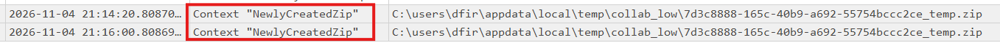

*Context tagged `NewlyCreatedZip`, with the timestamp and path of a zip file right after Defender saw it get created.*

Gives context about recently created zip files recorded by Defender, important for identifying staging activity, something commonly seen in many initial access tradecraft chains.

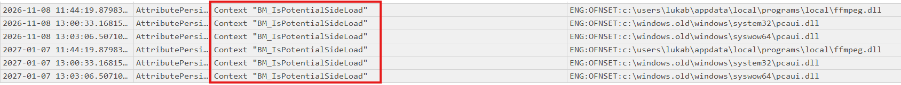

*`BM_IsPotentialSideLoad` tags on `ffmpeg.dll` and `pcaui.dll`, both sitting in uncommon locations.*

Identifies DLL files in uncommon locations, shows DLL potential side-loading indicators which could be additional investigation candidates.

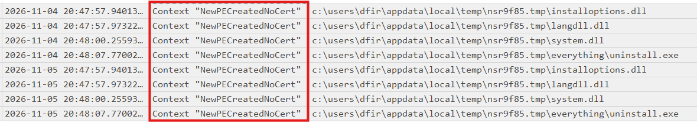

*`NewPECreatedNoCert` tags on several unsigned DLLs and an uninstaller dropped into a temp folder.*

Tracks recent creation (and execution, in the `ExecutedPENoCert` event) of PE files without a signed certificate. This artifact can support investigations into executable creation, installer extraction, and potentially suspicious file drops.

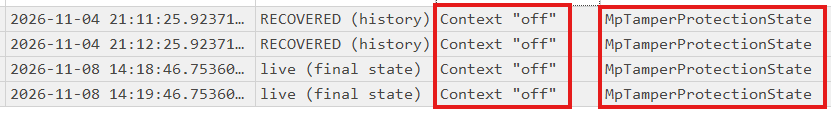

*A recovered row from the WAL (top) and the live final state (bottom), both showing `MpTamperProtectionState` set to `off`.*

It can also preserve the historical Tamper Protection state. In this example, a recovered record from the WAL contains `MpTamperProtectionState=off`, even though the record no longer exists in the final database state. This value should be interpreted carefully, since it can't be mapped directly to attacker activity. It just stores the last known state of `MpTamperProtectionState`, which could have been intentionally disabled by whoever administers the machine.

### RollingQueuesValues

Additional endpoint artifacts which can store evidence of internal network configuration, process execution (PID only), recent threats, and a per-process attack scoring entry mapped to the MITRE ATT&CK framework.

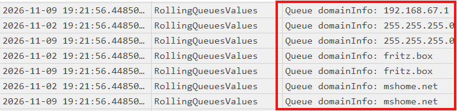

*Internal network information, DNS servers and domain names picked up from the host.*

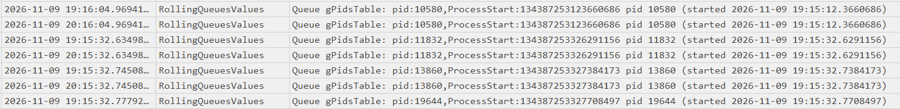

*A process's PID and its FILETIME-encoded start time, queued for attack scoring correlation.*

Stores process IDs and start times. This can help correlate Defender activity with other process execution artifacts, though it does not contain a complete execution history.

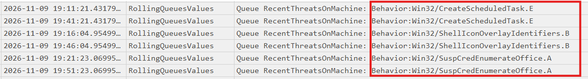

*Recent `Behavior:Win32/...` detections queued under `RecentThreatsOnMachine`.*

Stores recently recorded Defender threat names, which can help identify suspicious behavior and provide leads for further investigation.

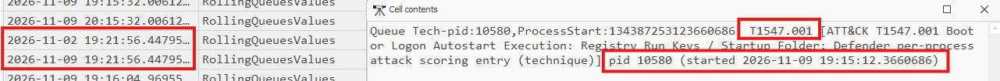

*A `Tech-pid` queue entry resolved to ATT&CK technique `T1547.001`, tied to a specific PID and process start time.*

Detected techniques per process, mapped to MITRE ATT&CK.

### FileLowFiAsync

Contains file paths and signature-related information for files processed by Defender's low-fidelity analysis mechanism. These records can help identify previously examined files and correlate them with other forensic artifacts.

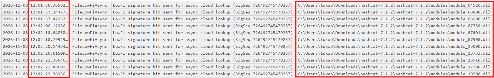

*LowFi signature hits sent for async cloud lookup, in this case against hashcat's module DLLs.*

### BackupProcessInfo

Stores Microsoft Defender's internal file and process related metadata, including executable paths, timestamps, and a `NextUSN` value. This value can be correlated with the NTFS USN Change Journal (`$UsnJrnl`), potentially helping investigators reconstruct file modifications, renames, and deletions.

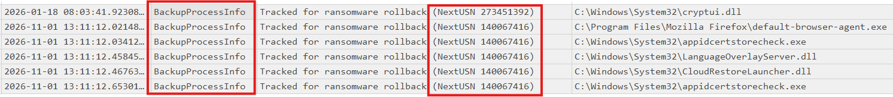

*Files tracked for ransomware rollback, each with its `NextUSN` value ready to correlate against `$UsnJrnl`.*

### FileHashes

At first, this might seem like a simple, self-explanatory table. However, it can be highly valuable because it contains a file's SHA-256 hash and its retrieved MFT entry number. This is especially useful in situations when the original file is no longer available on the filesystem, can't be recovered from memory, or when an attacker has deleted other forensic artifacts, like Sysmon logs or Amcache entries.

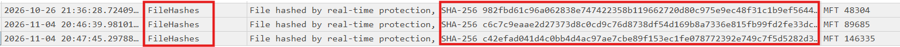

*Files hashed by real-time protection, with their SHA-256 and MFT entry number retained.*

### MetaInventory

Contains software inventory data like version changes, modules, and CPE (Common Platform Enumeration) identifiers for matching known CVEs.

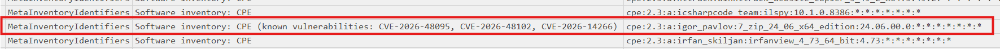

*A CPE entry for a specific 7-Zip build, flagged against three known CVEs.*

## SQLECmd can't decode it

SQLECmd reads the first 8 bytes of every file and only continues if they say `SQLite f`. In mpenginedb.db those bytes are encrypted too.

With default settings SQLECmd hunts through a folder, so the file is skipped without a word. You only see it with `--debug`, or when you point at the file directly, e.g.:

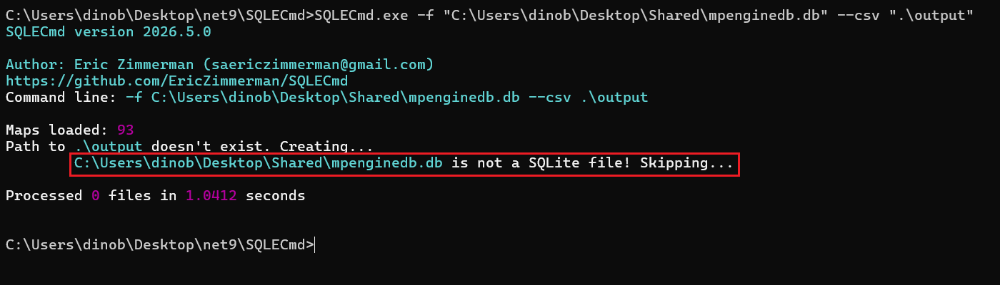

*SQLECmd refuses to process the file once it's pointed directly at it, logging it as "not a SQLite file."*

The tool never sees the database at all, and in a big collection nothing tells you it was missed unless you explicitly try to parse the database.

## Our tooling

We wrote two ways to work with this file.

### mpenginedb_parser.py

Github link: [https://github.com/Protokol-7/mpenginedb_parser](https://github.com/Protokol-7/mpenginedb_parser)

This is the full parser, made in Python with only the standard library.

Usage:

```
python mpenginedb_parser.py -f "...\mpenginedb.db" --wal "...\mpenginedb.db~wal" -o out
```

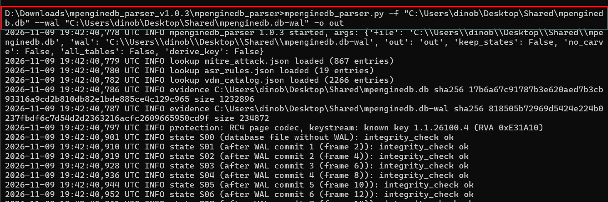

*The parser loading its lookup tables, hashing the evidence, and validating each WAL state in sequence.*

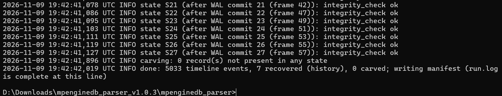

*The run finishing: every WAL state passes its integrity check, timeline events get written, manifest complete.*

It hashes the evidence before and after and never writes to it. It checks the WAL the way SQLite does, rebuilds the database after every saved transaction, and carves deleted rows with a quality flag for records that were partly overwritten. Every field is decoded: times in UTC, PID and process start, MFT numbers, the swapped hash columns, ATT&CK technique names, and ASR rule names. The main output is `timeline.csv`, plus one CSV per table, recovered rows, a report, a log, and a SHA-256 manifest. The `--derive-key` flag ignores the built-in key and rebuilds it from the evidence, so you can show the result does not depend on anything shipped with the tool.

### Decrypt-MpEngineDb.ps1 and an SQLECmd map

Github link: [https://github.com/Protokol-7/MpEngineDb_SQLECmd](https://github.com/Protokol-7/MpEngineDb_SQLECmd)

If you want to use the SQLECmd option, we created a PowerShell script that "prepares" (decodes) the database. It writes `mpenginedb_decrypted.db`, a normal SQLite file with the WAL already applied.

Usage:

```
.\Decrypt-MpEngineDb.ps1 -Path <Scans folder copy> -OutDir D:\case\mpdb
SQLECmd.exe -d D:\case\mpdb --csv D:\case\out
```

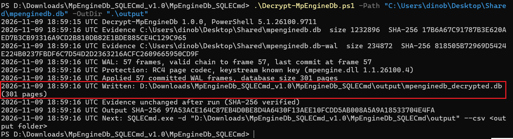

*The script hashes the evidence, validates and applies the WAL, and writes `mpenginedb_decrypted.db`.*

Then SQLECmd does the rest with the map `Windows_MicrosoftDefender_MpEngineDb.smap`. Note that you need to drop the map mentioned above into the SQLECmd `Maps` folder, or use the `--maps` flag in SQLECmd and point it at the path containing the `.smap`.

After the database is decrypted and the `.smap` file is dropped into the Maps folder, SQLECmd is ready for use:

```
SQLECmd.exe -f "D:\case\mpdb\mpenginedb.db" --csv "D:\case\out"
OR
SQLECmd.exe -f "D:\case\mpdb\mpenginedb.db" --csv "D:\case\out" --maps <folder with the .smap>
```

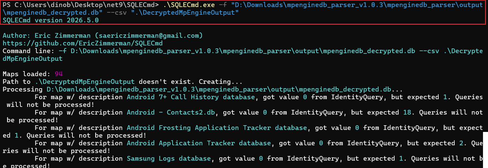

*SQLECmd running against the decrypted copy with the map loaded, output written normally.*

The map has 13 queries: attack scoring queues, path tags and ASR state, the hash cache, rollback tracking, LowFi hits, schema history, AMSI cache, blocked processes, monitored processes with command lines, ransomware detections, firewall rules, counters, and Controlled Folder Access paths. Times come out in UTC with the raw values next to them. The Python parser and the PowerShell script produce byte-identical decrypted databases. Deleted rows and per-transaction history are only available in the Python parser.

## Conclusion

mpenginedb.db works like a flight recorder for Defender. It keeps the engine's own view of what each process did, built from activity that often never turns into an alert, scored and queued internally whether or not anything ever surfaces in Protection History. Attack scoring tied to PID and process start, path tags on dropped or side-loaded files, a hash cache that survives after the original file is gone, rollback tracking that ties back into the USN Journal, none of it needs a detection to exist.

The encryption was never a real barrier. RC4 with a key reused across every page is weak on its own, and the key itself turned out to belong to the engine build rather than the machine, recoverable straight from the evidence file without ever touching `mpengine.dll`. That derivation doesn't depend on having seen a given build before, so it should hold even for builds we haven't tested, Windows 10 included.

SQLECmd walks past it without a word unless you already know to point at it directly, which is most likely why it's gone unnoticed in casework this long.

`mpenginedb_parser.py` and `Decrypt-MpEngineDb.ps1` plus the SQLECmd map are both linked above and produce identical decrypted output. Pick whichever fits the rest of your workflow.
